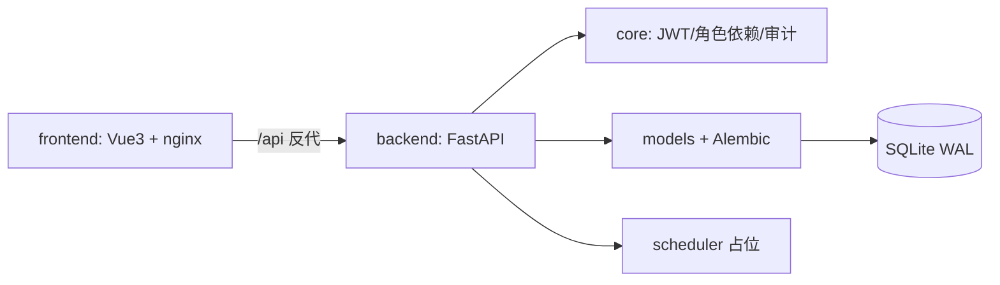

## Product Overview

运营支持系统（Green-OS）M0 基建阶段开发：按已定稿的 PRD v0.3.2 与 architecture.md v0.2，从零搭建可运行的项目骨架，为 M1 数据通做好地基。

## Core Features（M0 范围）

- **backend/ 骨架**：FastAPI 应用装配（含 Swagger）、core 层（配置/JWT/密码哈希/角色依赖/审计）、SQLAlchemy 2.x 模型与 Alembic 迁移、APScheduler 挂载占位、CLI（create-admin）
- **数据库首迁**：architecture.md §3.2 的 15 张业务表全部建表（operator/cs_member_binding/member/tag/blacklist/share_detail/rule/rule_experiment_member/rule_scan_log/task/task_state_log/touch_record/audit_log/sync_log/spider_cursor），关键唯一索引落地（uq_task→BR-03、uq(rule_id,member_id)→BR-11、cs_member_binding 部分唯一→R1）
- **登录与权限**：POST /api/auth/login 签发 JWT；require_cs / require_ops / require_admin 依赖（BR-10 服务端强制注入，不信任前端传参）；越权 403 并写 audit_log（只增不改不删）
- **frontend/ 骨架**：Vue3 + Vite + Element Plus，登录页 + 空壳工作台布局 + 路由守卫按角色显隐
- **部署**：docker-compose.yml（backend + frontend/nginx）+ Dockerfile + .env.example
- **测试骨架**：pytest，登录与越权用例可用，幂等/频控/分组稳定性占位
- **M0 明确不做**：spider 同步、规则引擎、任务生成、业务页面、SQLite→PG 切换
- **验收**：docker compose up 可启动 → 三种角色可登录 → Swagger 可访问 → alembic 迁移可重放 → 越权请求 403 且记审计

## 视觉效果

登录页为居中卡片式表单（系统名 + 账号密码），工作台为左侧菜单 + 顶部栏的后台布局，菜单项按角色显隐，M0 仅展示占位页。

## Tech Stack

- 后端：Python 3.11+ / FastAPI / SQLAlchemy 2.x / Alembic / APScheduler（内嵌，ADR-1）/ python-jose 或 pyjwt + passlib[bcrypt] / pytest
- 前端：Vue3 + Vite + Element Plus + Vue Router + Pinia + axios
- 数据库：SQLite（WAL 模式，`backend/data/app.db`，卷挂载），SQLAlchemy 抽象保证可切 PostgreSQL（ADR-2）
- 部署：Docker Compose 单机，nginx 托管前端静态资源并反代 `/api`

## Implementation Approach

- 严格按 architecture.md 落地，不引入新决策：分层为 api / services / models / schemas / scheduler / core；M0 的 services/scheduler 仅建包与占位，业务逻辑 M1+ 填充
- 16 张表全部含 `created_at/updated_at`（UTC）；外键用逻辑外键（不建物理 FK 约束），唯一索引与普通索引按 §3.2 建立
- `audit_log` 只增机制在 core 层封装唯一写入口，路由层无 UPDATE/DELETE 接口
- JWT 载荷含 operator id + role；权限依赖返回当前 operator 供路由直接使用（cs 路由不存在可传 cs_id 的参数）
- cs_member_binding 的"同会员仅一条 is_current=1"（R1）：SQLite 无 partial index，用 uniqueIndex(member_id, is_current) + 应用层校验 + 迁移内触发器兜底
- README 中已承诺的 CLI（create-admin/sync/scan）在 M0 提供 create-admin 与占位命令，sync/scan 打印"待 M1 实现"避免文档失配
- requirements.txt（根目录，为根目录脚本服务）保留不动；backend 单独建 requirements.txt

## Architecture Design



## Directory Structure

```
e:/code/fene_management_system/
├── docker-compose.yml        # [NEW] backend + frontend 两服务编排
├── .env.example              # [NEW] 环境变量样例（ZHLSZ_*、JWT_SECRET）
├── backend/
│   ├── Dockerfile            # [NEW] python:3.11-slim，uvicorn 启动
│   ├── requirements.txt      # [NEW] fastapi/uvicorn/sqlalchemy/alembic/apscheduler/pyjwt/passlib/python-dotenv/pytest
│   ├── alembic.ini           # [NEW]
│   ├── alembic/
│   │   ├── env.py            # [NEW] 指向 app.models.Base 与 DATABASE_URL
│   │   └── versions/0001_initial.py  # [NEW] 15 张表首迁（含索引与触发器）
│   └── app/
│       ├── main.py           # [NEW] FastAPI 装配、Swagger、静态异常处理、APScheduler 启动挂载
│       ├── cli.py            # [NEW] create-admin / sync(占位) / scan(占位)
│       ├── core/
│       │   ├── config.py     # [NEW] pydantic-settings：DATABASE_URL、JWT_SECRET 等
│       │   ├── security.py   # [NEW] 密码哈希、JWT 签发/校验
│       │   ├── deps.py       # [NEW] require_cs / require_ops / require_admin（BR-10）
│       │   ├── audit.py      # [NEW] audit_log 唯一写入口（只增）
│       │   └── db.py         # [NEW] engine/session（WAL PRAGMA）、Base、UTC 时间戳 Mixin
│       ├── models/           # [NEW] 15 张表 ORM（operator/member/binding/tag/blacklist/share_detail/rule/experiment/scan_log/task/state_log/touch/audit/sync/cursor）
│       ├── schemas/          # [NEW] LoginRequest/TokenResponse/OperatorOut 等
│       ├── api/
│       │   ├── auth.py       # [NEW] POST /api/auth/login、GET /api/auth/me
│       │   └── health.py     # [NEW] GET /api/health
│       └── scheduler/
│           └── jobs.py       # [NEW] APScheduler 实例与空任务占位
└── frontend/
    ├── Dockerfile            # [NEW] node:20 构建 + nginx:alpine 托管与反代
    ├── nginx.conf            # [NEW] /api 反代 backend:8000，SPA history 回退
    ├── package.json / vite.config.ts  # [NEW] dev 代理 /api → localhost:8000
    └── src/
        ├── main.ts / App.vue / router/  # [NEW] 路由守卫按 role 显隐
        ├── stores/auth.ts    # [NEW] Pinia：token 与 operator
        ├── api/auth.ts       # [NEW] axios 封装
        └── views/
            ├── LoginView.vue # [NEW] 居中卡片登录表单
            └── layout/       # [NEW] 左菜单+顶栏空壳，按角色显隐菜单，占位页
```

## Implementation Notes

- 部分唯一索引与触发器写在 Alembic 迁移内而非 ORM metadata，保证 upgrade head 可重放
- JWT_SECRET 必须从 .env 读取，禁止硬编码；.env 不入库，提供 .env.example
- SQLite 路径默认 `backend/data/app.db`，data/ 目录自动创建并加入 .gitignore
- 前端登录后按 role 跳转：cs → 工作台，ops → 运营后台，admin → 超管页；M0 均为占位页
- 测试用内存 SQLite + 迁移建表，覆盖：登录成功/失败、越权 403 且 audit_log 有记录、迁移重放幂等

## Design Style

后台管理系统骨架，采用 Element Plus 企业级风格：登录页居中白卡片 + 浅色渐变背景，工作台为经典左侧深色菜单 + 顶部面包屑栏的布局。M0 仅交付登录页与空壳布局，菜单项按角色（cs/ops/admin）显隐，内容区为占位卡片。交互以实用为先，为 M2+ 的任务列表/规则编辑器预留一致的卡片与表格风格。