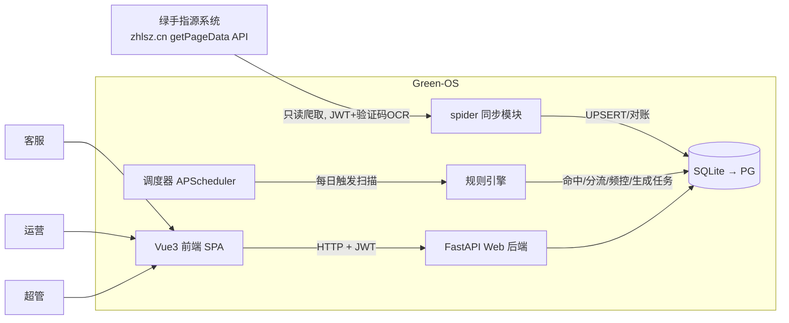
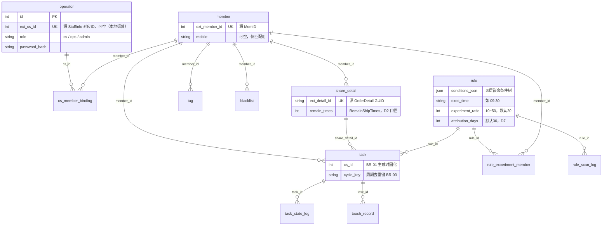
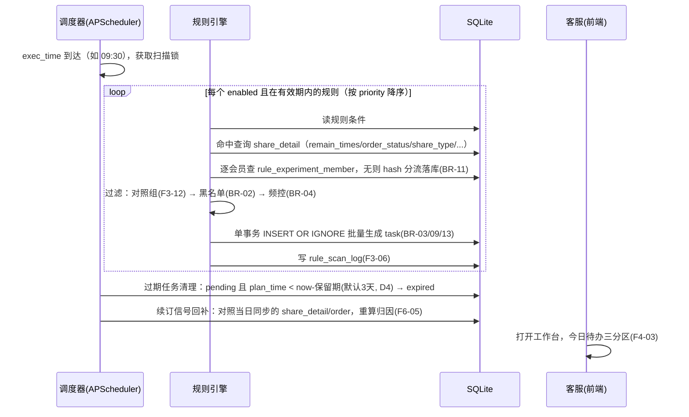
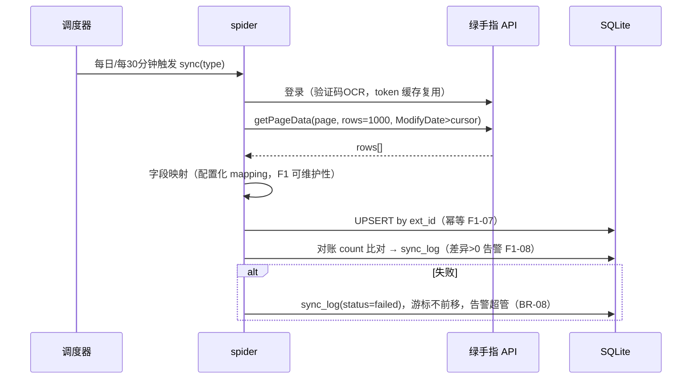

# 运营支持系统（Green-OS）架构设计文档

| 项目 | 内容 |
|---|---|
| 文档版本 | v0.2（评审决议 R1–R4 已并入，待定稿） |
| 更新日期 | 2026-11-21 |
| 依据 | PRD v0.3.1（决议 D1–D15） |
| 技术栈 | Python 3.11+ / FastAPI / SQLAlchemy 2.x / Alembic / APScheduler / Vue3 + Element Plus / SQLite（可切 PostgreSQL）/ Docker Compose |

---

## 1. 系统上下文（C4 Level 1）



- **数据流方向单向**：源系统 → spider → DB → 规则引擎 → 任务 → 前端。本系统对源系统**只读**（PRD 5.2 合规约束），不回写。
- 同步失败不阻断任务生成（BR-08）：规则引擎始终读 DB 中最后一次成功快照。

## 2. 容器视图（C4 Level 2）

| 容器 | 技术 | 职责 | 关键设计点 |
|---|---|---|---|
| Web 后端 | FastAPI + Uvicorn | REST API、鉴权、权限注入、审计 | 按角色分 router；BR-10 在依赖层强制注入 |
| 调度器 | APScheduler（**内嵌于 FastAPI 进程**，决议见 §8） | 每日同步任务、规则扫描、过期任务清理、数据回补 | `max_instances=1` + DB 扫描锁防重叠；支持手动重跑 |
| 规则引擎 | services 层纯函数模块 | 条件命中、hash 分流、频控、任务批量生成 | 与调度器解耦，可被手动试跑复用（F3-07） |
| spider | 独立包，由 `zhlsz_client.py` 改造 | 登录、增量拉取、字段映射、UPSERT、对账 | 限频 1~2 QPS；失败告警不中断 |
| 前端 | Vue3 + Element Plus + Vite | 运营后台 / 客服工作台 | 单 SPA，按角色显隐路由 |
| 数据库 | SQLite（WAL 模式）→ PostgreSQL | 全部业务数据 | Alembic 迁移；`data/app.db` 卷挂载 |

**MVP 部署形态（单容器或两容器均可）**：

```yaml
# docker-compose.yml（示意）
services:
  backend:
    build: ./backend          # uvicorn + APScheduler 同进程
    volumes: ["./data:/app/data"]   # SQLite 文件 + 备份
    env_file: .env            # ZHLSZ_* 凭证（加密后存 DB，日志脱敏）
  frontend:
    build: ./frontend         # nginx: 静态资源 + /api 反向代理
    ports: ["80:80"]
```

备份策略：SQLite `VACUUM INTO` 每日快照到 `data/backup/`，保留 30 天。

## 3. 数据库设计

### 3.1 ER 图



### 3.2 表结构（DDL 级）

> 全部表含 `created_at / updated_at`（UTC）与 Alembic 迁移；外键均逻辑外键（SQLite 下不启用物理 FK，切 PG 后启用），应用层保证。

**人员与归属**

| 表 | 关键字段 | 约束/索引 |
|---|---|---|
| `operator` | `id`, `ext_cs_id`(可空), `name`, `phone`, `qrcode_url`, `role`(cs/ops/admin), `status`(active/left), `password_hash` | `uq_operator_ext(ext_cs_id)` |
| `cs_member_binding` | `cs_id`, `member_id`, `is_current`, `source` | 【决议 R1】业务上同一会员同一时刻**仅一个专属客服**：建部分唯一索引（`member_id` where `is_current=1`，PG partial index，SQLite 用触发式校验）；同步发现重复归属时告警人工处理，不静默建多条 |
| `member` | `ext_member_id`(UK), `nickname`, `real_name`, `mobile`(ix), `another_phone`, `register_time`, `raw_json` | `uq_member_ext` |
| `tag` | `member_id`, `tag_type`(sys/manual), `tag_key`, `tag_value`, `expire_at`, `created_by` | `ix(member_id, tag_key)` |
| `blacklist` | `member_id`, `until_date`(可空), `reason`, `created_by` | `uq_blacklist_member`（活跃记录唯一） |

**份额明细（决议 D1/D2）**

| 表 | 关键字段 | 约束/索引 |
|---|---|---|
| `share_detail` | `ext_detail_id`(UK, 源 OrderDetail GUID), `member_id`, `ext_order_id`, `share_type`(shucai/doufu/douya), `good_name`, `total_cnt`, `shipped_cnt`, `remain_times`, `cycle_desc`, `start_ship_date`, `end_ship_date`, `order_status`, `sui_status`, `last_synced_at` | `ix(member_id)`、`ix(remain_times)`（命中条件高频）、`ix(order_status)` |

**规则与实验**

| 表 | 关键字段 | 约束/索引 |
|---|---|---|
| `rule` | `name`, `conditions_json`, `exec_time`, `freq`(daily/weekly+weekday), `plan_time`, `template`, `freq_n_days`, `freq_m_times`, `experiment_enabled`, `experiment_ratio`, `attribution_days`, `priority`, `status`(enabled/disabled/expired), `start_date`, `end_date`, `created_by` | — |
| `rule_experiment_member` | `rule_id`, `member_id`, `grp`(exp/ctrl), `assigned_at` | `uq(rule_id, member_id)` → **BR-11 分组永不变更：首次计算落库后只读** |
| `rule_scan_log` | `rule_id`, `scan_at`, `hit_count`, `exp_generated`, `ctrl_skipped`, `freq_skipped`, `blacklist_skipped`, `dedup_skipped`, `status`, `error`, `duration_ms` | `ix(rule_id, scan_at)` → F3-06 |

**任务与留痕**

| 表 | 关键字段 | 约束/索引 |
|---|---|---|
| `task` | `rule_id`, `cs_id`(生成时固化, BR-01), `member_id`, `share_detail_id`, `plan_time`, `cycle_key`(如 `2026-03-05`), `status`(pending/done/cancelled/expired), `result`(六枚举, 可空), `remark`, `copied_at`, `completed_at`, `expire_deadline`, `pool`(公共池标记, 决议 R4) | **`uq_task(member_id, rule_id, share_detail_id, cycle_key)` → BR-03**；`ix(cs_id, status, plan_time)` → 工作台列表；`ix(pool, status)` → 公共池认领页 |
| `task_state_log` | `task_id`, `from_status`, `to_status`, `operator_id`, `reason` | `ix(task_id)` → BR-07 |
| `touch_record` | `task_id`, `member_id`, `cs_id`, `content_snapshot`, `result`, `remark`, `latency_seconds`(生成→完成) | `ix(member_id, completed_at)` → 归因查询 |
| `audit_log` | `actor_id`, `action`, `object_type`, `object_id`, `detail_json`, `ip` | **只增不改不删**（应用层禁止 UPDATE/DELETE；导出/越权/分组查看全记录，F5-03） |

**同步与支撑**

| 表 | 关键字段 | 说明 |
|---|---|---|
| `sync_log` | `sync_type`(member/staff/order/share), `started_at`, `finished_at`, `status`, `total_source`, `total_local`, `diff_count`, `detail_json` | 对账报告（F1-08） |
| `spider_cursor` | `key`(表名), `last_sync_time` | 增量游标（`ModifyDate > cursor`） |

### 3.3 业务规则 → 设计机制对照（评审重点）

| BR | 设计机制 |
|---|---|
| BR-01 任务固化 cs_id | `task.cs_id` 生成时写入，此后绑定变更不回溯 |
| BR-02 黑名单 | 生成流水线第 1 道过滤；同时把该会员 `pending` 任务批量置 `cancelled(reason=进入黑名单)` |
| BR-03 去重 | `task` 唯一索引 + 生成用 `INSERT OR IGNORE`（PG 用 `ON CONFLICT DO NOTHING`），幂等 |
| BR-04 频控 | 生成事务内：按 `member_id` 统计近 N 天任务数（同日多条计 1，按 `plan_time::date` 去重计数）≥ 上限则跳过记日志；SQLite 单写锁天然串行，切 PG 后用生成批内 `SELECT FOR UPDATE` on member 批次 |
| BR-05 状态机 | 服务层枚举迁移表驱动，非法迁移抛错；`done` 无出边 |
| BR-06 离职转池 | 同步发现 `status=left` → 其 `pending` 任务 `cs_id` 置空标记为公共池（`pool=True`），运营可认领 |
| BR-07 留痕 | `task_state_log` + `audit_log`，应用层无删除接口 |
| BR-08 同步失败不阻断 | 扫描只读 DB；spider 失败写 `sync_log` + 告警，游标不前移 |
| BR-09 互斥 | 生成流水线内对 `(member_id, share_detail_id, plan_date)` 查当日已生成，多规则按 `rule.priority` 降序处理，其余记 `dedup_skipped` |
| BR-10 服务端隔离 | FastAPI 依赖：`require_cs` 返回 `operator`，任务/会员查询一律用 `current.id` 注入 where，**schema 中不暴露可传 cs_id 的参数**；越权返回 403 并写 `audit_log` |
| BR-11 分组不变 | 分流仅在该 `(rule_id, member_id)` 无记录时计算并落库；计算函数 `group = 'ctrl' if sha256(f"{member_id}:{rule_id}") % 100 < ratio else 'exp'` |
| BR-12 分组不可见 | 客服端 API 响应模型（Pydantic）中不存在任何分组字段；`rule_experiment_member` 查询仅 ops/admin 路由可达 |
| BR-13 任务粒度 | 任务带 `share_detail_id`，同一会员多份额命中各自生成；频控按会员（见 BR-04） |

## 4. 关键时序

### 4.1 每日规则扫描（核心链路）



### 4.2 数据同步



同步优先级与周期（M1）：`StaffInfo`（每日）→ `memberinfo`（每日全量，26,050 行 ≈ 14s）→ `OrderInfo(FenE)+OrderDetail`（每日增量）→ 归属重建（每次同步后）。

## 5. 后端分层与目录骨架

```
backend/
├── app/
│   ├── main.py              # FastAPI 装配 + APScheduler 启动
│   ├── core/
│   │   ├── security.py      # JWT 签发/校验、密码哈希
│   │   ├── deps.py          # require_cs / require_ops / require_admin（BR-10）
│   │   └── audit.py         # 审计写入（F5-03）
│   ├── api/
│   │   ├── auth.py          # POST /api/auth/login
│   │   ├── cs/              # 客服端：members / tasks / summary（无任何 cs_id 传参）
│   │   ├── ops/             # 运营端：rules / members / tasks / experiments / exports
│   │   └── admin/           # 超管端：sync tasks / rerun / operators
│   ├── services/
│   │   ├── rule_engine.py   # 条件求值（两层嵌套 JSON 树）
│   │   ├── pipeline.py      # 生成流水线：分流→黑名单→频控→去重→落库
│   │   ├── experiment.py    # hash 分流 + 均衡校验(F3-11) + 最小样本(F3-13)
│   │   ├── attribution.py   # 续订信号判定(D3) + 窗口归因 + 每日重算
│   │   └── report.py        # 看板聚合（F6-01/02/06/07）
│   ├── spider/
│   │   ├── client.py        # zhlsz_client.py 改造（加限频/重试/断点）
│   │   ├── mappings/        # 各表字段映射 YAML（配置化，可维护性）
│   │   └── sync.py          # 各 sync_type 的拉取→UPSERT→对账
│   ├── scheduler/
│   │   └── jobs.py          # sync / scan / expire / attribution 回补
│   ├── models/              # SQLAlchemy ORM（§3.2 全部表）
│   └── schemas/             # Pydantic 请求/响应模型
├── alembic/                 # 迁移
├── tests/                   # 幂等、越权、频控并发、分组稳定性（验收要点对应）
└── data/                    # app.db + backup/
```

## 6. 前端结构（Vue3）

```
frontend/src/
├── views/
│   ├── cs/                  # 客服工作台：今日待办(F4-03) / 任务详情 / 我的会员 / 今日小结(F4-11)
│   ├── ops/                 # 规则列表/编辑器(F3-02 命中预览+模板预览) / 会员360 / 任务总览 / 实验对比(F6-02) / 绩效
│   └── admin/               # 同步任务 / 对账报告 / 手动重跑 / 账号管理
├── api/                     # axios 封装，按 router 分文件
└── router/                  # 路由守卫按 role 显隐；无权限路由直接不可见
```

一键复制：`navigator.clipboard.writeText`，失败降级 `document.execCommand('copy')`（T5 HTTPS 未定前的兜底，F4-05）。

## 7. API 面概览

| 方法 | 路径 | 角色 | 说明 |
|---|---|---|---|
| POST | `/api/auth/login` | 公开 | 账号密码 → JWT |
| GET | `/api/cs/tasks/today` | cs | 今日待办三分区（服务端注入 cs_id） |
| POST | `/api/cs/tasks/{id}/copy` | cs | 复制留痕 |
| POST | `/api/cs/tasks/{id}/complete` | cs | 结果枚举 + 备注（「其他」必填，D11） |
| GET | `/api/cs/members` / `/api/cs/summary` | cs | 我的会员 / 今日小结 |
| CRUD | `/api/ops/rules` (+ `/preview` `/dry-run`) | ops | F3-01/04/07 |
| GET | `/api/ops/reports/rule-experiment/{id}` | ops | F6-02 对比看板 |
| POST | `/api/admin/sync/{type}/run` | admin | 手动重跑（F1-10） |
| GET | `/api/admin/sync-logs` | admin | 对账报告 |

## 8. 关键设计决策记录（ADR 摘要）

| # | 决策 | 理由 | 备选与放弃原因 |
|---|---|---|---|
| ADR-1 | 调度器内嵌 FastAPI 进程（APScheduler） | 规模小、单机部署、省一个容器与进程间通信；`max_instances=1` 防重叠 | 独立 worker 容器：隔离性好但 MVP 过度设计；M4 后若扫描耗时长再拆 |
| ADR-2 | SQLite(WAL) 起步，SQLAlchemy+Alembic 保持 PG 兼容 | 数据量 ≤ 数十万行，单写者与 BR-04 串行化天然契合；部署最简 | 直接 PG：多一个容器运维成本 |
| ADR-3 | 分流落库制（`rule_experiment_member`）而非纯函数即时计算 | BR-11「永不变更」需要可审计的持久事实；重跑/重启天然稳定 | 纯 hash 即时计算：依赖 ratio 不变（改比例会翻组），落库制同时解决比例可调（D8） |
| ADR-4 | 任务幂等靠唯一索引 + INSERT OR IGNORE，而非先查后插 | 并发/重跑安全，符合验收要点「重复提交不产生重复任务」 | 应用层查重：有竞态窗口 |
| ADR-5 | 条件树存 `conditions_json`（两层嵌套），前端可视化编辑器生成 | F3-02 不写 SQL；两层嵌套边界由 schema 校验强制 | 表达式 DSL：运营不可维护 |
| ADR-6 | spider 字段映射 YAML 配置化 | 源系统改版时只改映射不改代码（可维护性） | 硬编码 ORM 直写 |

**SQLite → PostgreSQL 切换触发条件**：① 出现写并发瓶颈（锁等待）② 单表 > 100 万行 ③ 需要多实例部署。切换动作为：改连接串 + Alembic 迁移 + 验证 4 个依赖串行化的服务层用例。

## 9. 与里程碑的对接

| 里程碑 | 本文档对应交付 |
|---|---|
| M0 | 目录骨架、Alembic 首个迁移（§3.2 全表）、JWT/角色依赖（§5 core）、Docker Compose |
| M1 | spider 改造 + mappings、sync/sync_log/spider_cursor、会员 360 API |
| M2 | rule_engine + pipeline + experiment、task 状态机、客服工作台 API |
| M3 | rules 可视化编辑器、report.py、实验对比看板 |
| M4 | attribution 重算、绩效、告警巡检、PG 切换演练 |

## 10. 评审决议（2026-11-21，R1–R4 已确认）

| # | 决议 | 内容 |
|---|---|---|
| R1 | 归属唯一性 | 同一会员同一时刻**仅一个专属客服**；`cs_member_binding` 建部分唯一索引，同步发现重复归属告警人工处理（§3.2 已更新） |
| R2 | 人群包暂缓 | F2-05 `member_segment` 表 M0–M2 不建，M3 或后续迭代再加；规则条件先直接引用标签/剩余次数等，不依赖人群包 |
| R3 | ADR 认可 | ADR-1（调度器内嵌 FastAPI 进程）与 ADR-3（分流落库制）均评审通过，BR → 机制对照表（§3.3）无异议 |
| R4 | 公共池 | `task.pool=True` 标记 + 运营后台「公共池待办」认领列表页（`ix(pool, status)`）；本期不做指派 |

**变更记录**

| 版本 | 日期 | 说明 |
|---|---|---|
| v0.1 | 2026-11-21 | 初稿（含 5 项评审检查单） |
| v0.2 | 2026-11-21 | 并入评审决议 R1–R4：归属绑定唯一化（部分唯一索引）、人群包暂缓、ADR-1/ADR-3 认可、公共池采用标记+认领页（task 表补 pool 字段与索引） |
