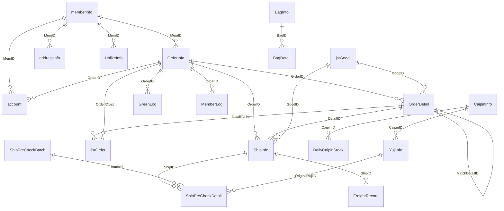

# 绿手指份额管理系统 — 数据模型逆向分析

> 分析方法：以 42 个业务页面菜单（`/api/menu/getTreeMenu`）为索引，对每张表调用 `POST /api/<表>/getPageData` 取真实行样本，抽取全部字段名、类型与样例值；结合数据字典枚举推断语义。机器可读全量结构见 `schema.json`（42 表字段+样例+行数），枚举见 `dictionaries.json`（33 个字典）。
>
> 行数统计时间：2026-11-15。

## 一、系统架构推断

| 层 | 证据 | 结论 |
|---|---|---|
| 前端 | Vue CLI SPA，项目名 `vol`，菜单含 tableName/permission | **VOL 框架**（开源 .NET+Vue 快速开发框架， www.volcore.xyz）风格 |
| 后端 | 响应头 `Server: Kestrel`；`/api/<表>/getPageData`、`/api/Sys_Dictionary/GetVueDictionary`、JWT(`iss=ZH,aud=Lsz`) | .NET Core (ASP.NET Core)，代码优先按 VOL 代码生成器组织 |
| 数据库 | GUID 主键、`wheres` 动态条件、GetVueDictionary 配置式字典 | 大概率 SQL Server / MySQL；菜单 id 96/146/… 为 Sys_Menu 表自增主键 |
| 实时通信 | `/hub/message/negotiate?userName=xxx` | SignalR |
| 外部集成 | `yz_open_id`、`tid/oid/YzTID`、`pay_time` 等有赞字段原样入表；`JST_SKU_ID/LocalJstCode/JstID` | **有赞商城**（多平台：抖音/淘宝/小红书/视频号/快手/线下）与**聚水潭 ERP** 双向同步 |
| 鉴权 | JWT 2h，jti=用户ID(3390)，Sys_Menu 权限点 | VOL 标准用户/角色/菜单权限体系（本次账号非管理员，未见 Sys_User 等系统表） |

## 二、核心 ER 关系图

业务主线：**会员下单（有赞/线下）→ OrderInfo 主订单 → OrderDetail 明细（匹配份额 MatchDetailID）→ 审单 → ShipInfo 配送单 → 打包(Bag) / 拣菜(JianCai) / 预检(PreCheck) → 推送聚水潭(JstOrder) 发货**。账户余额变化全程经 `account` 流水记录。

## 三、实体清单与字段规模

| 分组 | 表 | 行数 | 字段数 | 说明 |
|---|---|---|---|---|
| 会员域 | `memberinfo` | 25,907 | 41 | 会员主档，PK=`MemID`(int) |
| | `addressinfo` | 49,864 | 31 | 收货地址，PK=`AddressID` |
| | `account` | 140,671 | 14 | 账户流水（余额快照式：OldBalance/Change/Balance） |
| | `UnlikeInfo` | 7,347 | 12 | 忌口/喜好（按 MemID+AddressID+FeneType） |
| | `MemberLog` | 427,105 | 15 | 会员操作日志（含 OrderID/DetailID/ShipID 关联） |
| | `AccountForBox` / `AccountForJianpei` | 1,348 / 2,429 | 15 | 纸箱回收 / 减配账户流水 |
| 订单域 | `OrderInfo` | 298,728 | 81 | 主订单，PK=`ID`(GUID) |
| | `OrderDetail` | （大表，按 OrderID 过滤取样） | 93 | 订单明细，PK=`ID`(GUID) |
| | `GreenLog` | 2,127,468 | 15 | 订单日志（OrderID/DetailID/ShipID） |
| 配送域 | `ShipInfo` | 671,238 | 70 | 配送单（实际是"明细级配送计划/记录"） |
| | `BagInfo` / `BagDetail` | 3,705 / 296,640 | 8 / 35 | 打包批次 / 打包明细（BagID 关联） |
| | `JianCaiInfo` / `JianCaiDetail` | 3,115 / 393,013 | 8 / 18 | 拣菜批次 / 明细 |
| | `ShipPreCheckBatch` / `Detail` / `Stat` | 2,793 / 1,517,142 / 150,751 | 11 / 30 / 12 | 预检批次/明细/统计 |
| | `FreightRecord` | 5 | 20 | 补送运费 |
| 商品域 | `jstGood` | 28,548 | 77 | 商品 SKU 主档（聚水潭同步），PK=`ID` |
| | `CaipinInfo` | 317 | 15 | 菜品（GreenCode 编码，按 FeneType 分类） |
| | `DailyCaipinStock` | 15,888 | 15 | 每日菜品库存（CaipinID+ShipDate+基地） |
| | `YujiInfo` | 41,729 | 14 | 菜品预计用量（含 BackupCaipinID 备选菜） |
| 聚水潭域 | `JstOrder` | 166,649 | 52 | 聚水潭发货单（OrderIDList/DetailIDList/ShipIDList 为 JSON 数组字段） |
| 状态视图 | `OrderInfoToAduited/Aduited/Paused/Problem/Completed/Sandan` | 合计≈299k | 81 | **与 OrderInfo 字段完全一致**，按 OrderStatus 过滤的视图/同结构控制器 |
| | `ShipInfoToAduited/OnShip/Aduited/Paused` | 合计≈671k | 70 | 与 ShipInfo 字段一致，按 ShipStatus 过滤 |
| | `ViewUnlikeList` | 7,347 | 22 | 忌口汇总视图（memberinfo+addressinfo join） |
| 归档 | `orderinfo_archive` / `orderdetail_archive` / `shipinfo_archive` | 26,602 / 39,189 / 337,411 | 81 / 89 / 70 | 完结订单归档；归档明细=在线明细减去 4 个匹配列（GoodShipWay/MatchDetailID/MatchShipWay/RuleShipWay），即**匹配信息在归档时被剥离** |
| 系统 | `Sys_Log` / `ApiLog` / `StaffInfo` | 3.6M / 661k / 10 | 16 / 24 / 11 | 操作日志 / 接口日志 / 客服（含 MemberList） |
| | `addressinfoSelfFetchPoint` | 41 | 31 | 自提点（addressinfo 同结构） |

## 四、核心实体字段明细（按域分组）

### 4.1 memberinfo（会员）

- **标识**：`MemID`(PK,int) 、`Yz_Open_ID`/`outer_user_id`/`buyer_id`（有赞用户 ID）、`fans_id/fans_type`、`OldMemID`（数据迁移链）
- **资料**：`RealName/NickName/Gender(字典SexSelector)/Mobile/AnotherPhone/Birthday/Province/City/Country/Avatar`
- **账户配置**：`Account`（余额）、`WarehouseBase`（默认发货基地，字典）、`CollectFreight`（是否收运费）
- **纸箱回收**：`IsWantBoxRecycle/BoxRecycleCount/BoxRecycleDefaultGiftCount`
- **减配补送**：`IsWantSubShip/SubShipCount/SubShipDefaultGiftCount`
- **偏好**：`LikeProduct/UnLikeProduct/OtherDemand/Platform_Type/PlatformType`
- **审计**：`CreateID/Creator/CreateDate/ModifyID/Modifier/ModifyDate`（VOL 标准审计列，全表一致）

### 4.2 OrderInfo（主订单，81 字段）

- **标识/来源**：`ID`(GUID,PK)、`tid`（有赞订单号）、`PlatformType`（字典 OrderPlatformType：有赞/抖音/淘宝/小红书/视频号/线下/旧平台/快手/分销线下）、`OrderType`（FenE 份额/SanDan 散单/HunHe 混合）、`OldOrderID`、`MatchOrderID`
- **客户**：`MemID`(FK)、`ConsigneeName/PhoneNumber/WholeAddress/ProvinceName/CityName/CountyName/AddressText/AddressID`(FK addressinfo)
- **金额**：`TotalPrice/TotalGoodPrice/TotalDeliveryFee/DeliveryFee/TotalShipedGoodPrice/TotalShipedDeliveryFee/OldTotalPrice/pay_type/pay_type_str`
- **配送**：`ShipType`(express/fetch/local)、`ShipWay`(Air/Land/Both)、`ShipCompany`、`WarehouseBase`、`WantShipDate`、`ShipedTimes/RemainShipTimes/TotalShipCount/ShipedCount/RemainShipCount`
- **状态**：`OrderStatus`(1待审核/2已审核/3已完结/4暂停/5异常/6仅展示/0删除)、`status/status_str`（有赞原始状态）、`close_type/refund_state/expired_time` 等有赞生命周期字段、`SuiFenePeisongStatus`（字典 SuiFenEStatus：份额匹配状态机）、`ExceptionalReson`（异常原因）、`IsSyncToLocal`
- **有赞原生透传**：`buyer_message/trade_memo/created/pay_time/consign_time/confirm_time/success_time/update_time/root_kdt_id/node_kdt_id/offline_id/team_type/order_url/activity_type/is_retail_order`
- **冗余明细摘要**：`DetailShortNameList/DetailSkuTextList/DetailPriceList/DetailRemainTimesList/DetailRemainCountList`（列表型字符串列）
- **员工**：`Staff`（字典 StaffSelector）

### 4.3 OrderDetail（订单明细，93 字段）

- **标识/外键**：`ID`(GUID,PK)、`OrderID`(FK OrderInfo)、`MemID`、`GoodID`(FK jstGood)、`MatchDetailID`（份额匹配的自引用：份额明细 ↔ 散单明细）、`OldDetailID`、有赞：`YzTID/oid/outer_sku_id/item_id/sku_id/...`
- **业务量**：`SingleCount/TotalCount/ShipedCount/RemainShipCount`（数量）与 `LoopShipCount/LoopShipedTimes/RemainShipTimes`（次数）——**"配送次数"是份额业务核心概念**（一份份额每周配一次，共 N 次）
- **金额**：`TotalPrice/UnitPrice/LocalDiscount/DeliveryFee/payment/discount_price/total_fee/freight/points_price/...` 及聚水潭分销字段 `fenxiao_*`
- **循环配送**：`LoopShipType/LoopShipDescription/LoopShipDetail/StartShipDate/LastShipDate/EndShipDate`
- **匹配信息**：`GoodShipWay/MatchShipWay/RuleShipWay`（运输方式匹配三态，归档时被剥离）
- **打包**：`BoxType`(装箱/不装箱)、`BagType`(常温/冷藏-大件/肉/份额)、`GroupMark`、`BinText/BinQty`（箱规）
- **偏好冗余**：`LikeProduct/UnLikeProduct/OtherDemand`（从会员/地址复制到明细，配送时只看明细）

### 4.4 ShipInfo（配送记录，70 字段）

PK=`ID`(GUID)；FK：`OrderID`、`DetailID`(FK OrderDetail)、`MemID`、`GoodID`。
一条 ShipInfo = **一个订单明细的一次配送**。关键字段：`Count/UnitPrice/TotalPrice/ShipDate/Status(ShipStatus: 1待配送/6配送中/2已完成/4暂停配送/3备用)`、`BinText/BinQty/BoxType/BagType/GroupMark`、`SyncJstStatus/LocalJstCode/JstExpressCode/YzExpressStatus`（聚水潭/有赞回传）、`isCollectedFreight/CollectedFreightPrice/BoxGiftCount/SubGiftCount`、`AutoID/OldShipID`。

### 4.5 account（账户流水）

`MemID + Action(字典 Actions: 充值/扣费/系统/返现/充值减配/充值纸箱) + OldBalance/Change/Balance + Reason + OrderID`。
设计要点：**每行保存交易前后余额快照**，可从任意行审计全账。

### 4.6 菜品/库存/预检（生产计划域）

- `CaipinInfo`：菜品档案，`GreenCode` 唯一编码、`FeneType`(shucai 蔬菜/doufu 豆制品/douya 豆芽)、`GoodJstSkuCode` 关联聚水潭 SKU。
- `YujiInfo`（预计）：按 `WarehouseBase+ShipDate+FeneType` 预计每个配送日的菜品用量与重量，含 `BackupCaipinID` 备选菜。
- `DailyCaipinStock`：每日实际库存 `Stock/Weighting`，FK `CaipinID`。
- `ShipPreCheckBatch → ShipPreCheckDetail`：预检（配送前菜品替换检查），明细含 `IsReplaced/ReplaceProcess/ReplaceReason/IsBackupUsed/DeductedWeight/OriginalCaipinName/BackupCaipinName/OriginalYujiID` —— 完整记录"预计菜→实际菜"的替换链。

### 4.7 聚水潭域

- `jstGood`：77 字段，聚水潭 SKU 全量镜像（`sku_id/i_id/autoid` + 本地扩展：`SingleCount/TotalCount/LoopShip*` 份额配送参数、`BoxType/BinText/BinQty` 箱规、`DefaultBoxCost/DefaultSubCost`）。
- `JstOrder`：发货单，通过 `OrderIDList/DetailIDList/ShipIDList/TidList/RemainTimeList/RemainCountList`（JSON 数组字符串）弱关联多订单/明细/配送单——**聚水潭侧合并发货，本地用 JSON 列表维护映射**；`LocalJstCode/JstID/ExpressCode/shop_status` 为回传状态。

## 五、字典（枚举维度表）

`/api/Sys_Dictionary/GetVueDictionary` 共 33 个（全量见 `dictionaries.json`），核心业务枚举：

| 字典 | 取值 |
|---|---|
| `OrderStatus` | 0删除 / 1待审核 / 2已审核 / 3已完结 / 4暂停 / 5异常 / 6仅展示 |
| `ShipStatus` | 1待配送 / 6配送中 / 2已完成 / 4暂停配送 / 3备用 |
| `SuiFenEStatus` | NotFindFenE 匹配份额失败 / TrySuiFenE 尝试匹配 / NotSuiFenE 不随份额配送 / DoSuiFenE 匹配成功 / ShipWayDiff 运输方式不一致 / CompleteOrder 已完结 / ProblemOrder 异常 / UndoFindFenE 解除匹配 |
| `OrderType` / `DetailType` | FenE 份额 / SanDan 散单 / HunHe 混合 |
| `FeneType` | shucai 蔬菜份额 / doufu 豆制品份额 / douya 豆芽份额 |
| `ShipType` | express 快递 / fetch 自提 / local 同城 |
| `ShipWay` | Air 空运 / Land 陆运 / Both 空陆皆可 |
| `Actions`(账户) | 充值 / 扣费 / 系统 / 返现 / 充值减配 / 充值纸箱 |
| `OrderPlatformType` | 有赞 / 抖音 / 淘宝 / 小红书 / 视频号 / 线下 / 旧平台 / 快手 / 分销线下 |
| `BagTypeSelect` | Normal 常温 / Freeze 冷藏-大件 / Meat 肉 / FenE 份额 |
| `BoxType` | Box 装箱 / UnBox 不装箱 |
| `UploadJstStatus` | Uploaded 已上传平台 / Build 已生成订单 / Sent 平台已发货 |

其余为选择器字典（MemberSelect 全会员下拉、WarehouseBaseSelector 发货基地、省市县三级、ShipCompany 快递公司等）。

## 六、设计特征与复刻要点（迭代升级注意事项）

1. **VOL 框架约定**：所有表带 `ID + CreateID/Creator/CreateDate/ModifyID/Modifier/ModifyDate` 审计六列；分页协议固定 `{page,rows,sort,order,wheres}`，`wheres` 是 JSON 字符串；字典配置化（Sys_Dictionary 的 config 存 valueField/textField 表达式）。复刻后端时按此约定可无缝对接现有前端。
2. **状态视图复用主表结构**：`OrderInfo*` 六个页面共用 81 字段同构表/视图，仅 OrderStatus 不同；`ShipInfo*` 四个页面同理。数据库层可用视图实现，后端一个控制器 + 状态路由。
3. **双主键风格并存**：会员用 int 自增（`MemID`），订单域全部 GUID（有赞同步与合并发货需要）。新表建议沿用 GUID。
4. **弱关联用 JSON 列表列**：JstOrder/BagDetail 的 `OrderIDList/DetailIDList/ShipIDList/RemainTimeList`。若重构建议改为真正的关联表（如 JstOrderShip），当前设计无法用 SQL 保证一致性。
5. **冗余即快照**：收件人/地址/喜好在订单、明细、配送单三层各自复制一份（下单时快照，改地址不回溯）；余额流水带前后快照。逆向时注意这些冗余列是"历史事实"，不要试图归一化。
6. **有赞字段原样保留**：OrderInfo/OrderDetail 中大量 `tid/oid/pay_time/root_kdt_id` 等是 API 原始透传，是同步幂等与对账的依据，重构时需保留原始报文字段或另存 raw 表。
7. **大表性能**：`OrderDetail` 全表分页 COUNT 超时（百万级无优化），`GreenLog/Sys_Log` 300 万+。自建系统需加 `(OrderID)` 索引与归档分区（现系统用 `_archive` 物理表手工归档，且归档时剥离匹配列）。
8. **权限模型**：菜单权限点（Search/Export/Update/审单 AduitedOrder/AduitedShip/Archive/Sync 等）按表配置，接口侧未做行级权限（账号 fupenzi 能看到全部 25,907 会员手机号——重构时建议加数据权限）。
9. **未覆盖区域**：当前账号非管理员，`Sys_User/Sys_Role/Sys_Menu` 等系统配置表、写操作（Add/Update/审单）的具体请求协议未逆向；如需完整复刻需管理员账号再抓一轮。

## 七、产出文件

| 文件 | 内容 |
|---|---|
| `data_model.md` | 本文档 |
| `schema.json` | 42 表 × 全字段（名称/推断类型/样例值）+ 行数 |
| `dictionaries.json` | 33 个数据字典枚举全量 |
